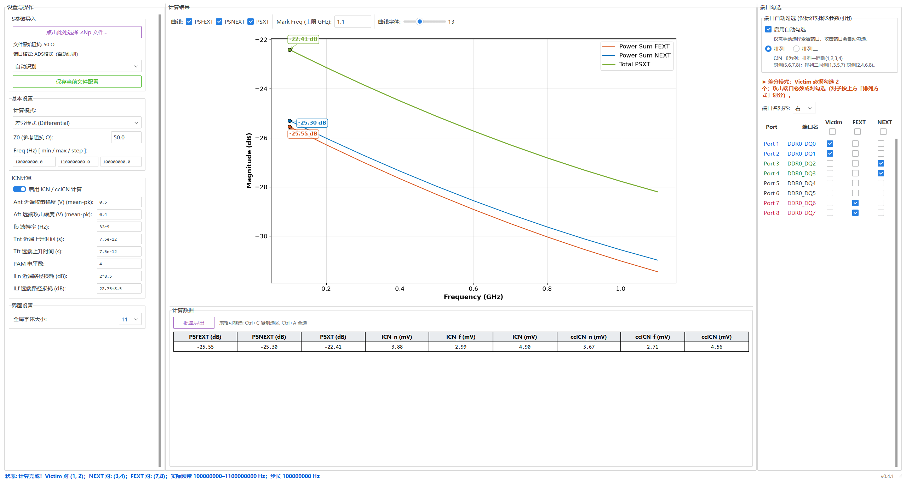
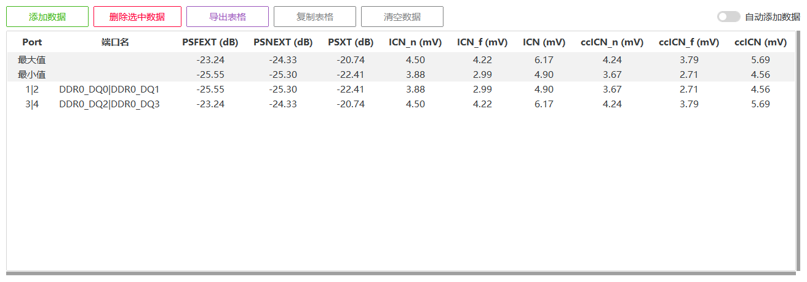

# S参数串扰计算工具 v0.5.0

面向信号完整性（SI）分析的桌面工具。导入 Touchstone（`.sNp`）S 参数文件，选择受害端口（Victim）与攻击端口，计算 **PSFEXT（远端串扰）、PSNEXT（近端串扰）、PSXT（总串扰）**，并绘制频率曲线。支持单端、差分模式以及 **ICN / ccICN 集成串扰噪声**计算，适合比较 DDR/LPDDR 等并行总线不同布线方案的串扰结果。

- 支持 Cadence、Ansys、ADS 等常见端口注释格式，自动识别端口名，也可手动指定格式。
- 支持端口自动勾选、曲线峰值标注、ICN 单位自适应显示。
- 支持批量缓存多组端口结果、复制表格和导出 CSV。
- 支持按 S 参数文件保存界面配置。

版本变更见 [CHANGELOG](CHANGELOG.md)。

## 软件界面

以下截图使用仓库附带的 [demo.s8p](sample_data/demo.s8p) 合成演示数据，不代表实际产品测量结果。

### 主界面

左侧设置输入与计算参数，中间显示串扰曲线和计算结果，右侧选择 Victim、FEXT、NEXT 端口。三栏分隔线可拖动，界面和曲线字体可分别调整。



### 批量导出

可逐组添加端口结果后统一导出。按钮行最右侧的「自动添加数据」开关默认关闭，需要连续采集时再启用。



## 从源码运行

本仓库提供源码、示例数据和文档。

### 环境准备

推荐使用 **Windows + Python 3.14**；当前验证环境为 Windows / Python 3.14.5。代码要求 Python 3.12+，依赖的固定版本见 [requirements.txt](requirements.txt)，安装时还需满足这些依赖自身的 Python 版本要求。其他操作系统尚未验证。

安装 Python 时需包含 **Tcl/Tk（tkinter）**，以便显示桌面窗口。

### 获取源码并安装依赖

安装 Git 后，在 PowerShell 或命令提示符中执行：

```powershell
git clone https://github.com/ghostdavid/spara_xtalk_icn.git
cd spara_xtalk_icn
py -3.14 -m venv .venv
.\.venv\Scripts\python.exe -m pip install -r requirements.txt
```

也可以在仓库页面选择 **Code → Download ZIP**，解压后进入项目目录，再执行创建虚拟环境和安装依赖的命令。以下命令均在项目根目录执行，直接使用虚拟环境中的 Python，无需激活环境。

### 启动程序

```powershell
.\.venv\Scripts\python.exe -B main.py
```

也可在启动时导入示例或自己的文件：

```powershell
.\.venv\Scripts\python.exe -B main.py sample_data/demo.s8p
.\.venv\Scripts\python.exe -B main.py "C:\data\channel.s16p"
```

## 第一次使用

1. 点击导入按钮选择 `.sNp` 文件，检查参考阻抗、文件频带、端口名和自动识别的端口格式。识别不正确时，可在下拉框中手动指定格式。
2. 选择单端或差分模式及排列方式，勾选 Victim、FEXT、NEXT。启用端口自动勾选可以按排列规则推演攻击端口，也可关闭后手动选择。
3. 设置 Z0 和 Freq min/max/step。频率输入单位为 **Hz**，支持科学计数法和数学表达式。建议先使用文件已有的频带。
4. 需要 ICN 时开启「启用 ICN / ccICN 计算」，并根据实际信号设置攻击幅度、波特率、上升时间、PAM 和损耗。导入没有保存配置的文件时，ICN 默认关闭。
5. 设置 **Mark Freq（GHz）**，读取该频率上限以内的峰值。Mark 为空或小于首个计算频点时，不显示峰值结果。
6. 打开「批量导出」，点击「添加数据」缓存当前结果。切换端口后可继续添加，最后导出 CSV 或复制整张表格。

操作时留意底部状态栏：这里会显示计算错误、实际采用的端口对子、计算频带及频带延拓警告。

## 多线程与 GPU

“基本设置”提供以下选项，随文件配置或默认配置保存：

- **CPU 线程数**：默认“自动”（可用逻辑处理器数减一，至少一个），也可指定线程数。它控制数值工作预算，不是整个程序或显卡驱动的线程总数。线程越多不一定越快。
- **计算后端**：自动 / CPU / GPU。自动模式对较小的源矩阵使用 CPU；GPU 模式尝试使用所选设备。设置下方显示实际计算路径及回退原因。
- **GPU 设备**：自动选择或指定支持双精度的 OpenCL GPU。后端面向 Intel、AMD、NVIDIA，但需要设备驱动提供 OpenCL 和双精度能力；目前真实硬件验证为 Intel，AMD/NVIDIA 尚未实测。

文件加载、重新解析、数值计算、峰值准备和 CSV 导出在后台进行；改变输入会丢弃旧任务结果。CPU 对插值通道并行处理并控制数值库内部线程。GPU 用于双精度 PCHIP、耦合运算、PowerSum 与 ICN 公式数组运算；阻抗归一化等仍使用 CPU，因此界面显示“混合计算”。

缺少 GPU 库、驱动、双精度能力或设备运行失败时使用 CPU 并提示原因，不降低计算精度。首次 GPU 编译及数据传输有开销，不保证比 CPU 快。Matplotlib 最终布局和画布绘制仍在主线程使用 CPU，并非 GPU 绘图。导出进行中请等待完成后关闭程序。

## 结果与配置

### 曲线和数据表

- 曲线开关控制 PSFEXT、PSNEXT、PSXT 的显示和对应峰值列。峰值仅在不超过 Mark 的计算点中搜索，不插入额外频点。
- ICN/ccICN 在 V、mV、µV、nV、pV 间自适应显示，界面保留两位小数。计算数据表支持框选后按 Ctrl+C 复制。
- 输入变化或计算失败后会清空旧结果；重算/重绘尚未完成时不能采集旧结果。ICN 失败时可保留有效 PowerSum 曲线，并在状态栏提示原因。

### 批量采集与 CSV

「自动添加数据」默认关闭。启用后，只要批量窗口打开，切换端口或刷新结果就会自动缓存一行；与末行完全相同的结果会跳过。

切换开关本身不会添加数据，关闭开关不会清空已有记录，手动添加始终可用。同一次运行中关闭再打开批量窗口会保留开关选择，重启应用后恢复关闭，该选项不写入配置。

- 可删除选中行、清空列表，或复制整表到 Excel 等工具。
- 差分 Victim 的两个端口在同一行中以 `|` 连接。
- CSV 使用 UTF-8 BOM 编码，导出缓存中存在的结果列；PowerSum 单位为 **dB**，ICN/ccICN 固定为 **V**，列名带单位。
- CSV 数值保留 **17 位有效数字**，不受界面两位小数和自适应单位影响。缺失结果留空，零功率的 dB 值为 `-inf`。

### 保存配置

文件配置保存为 S 参数文件同名的 `.json`；未导入文件时可保存默认配置 `spara_ui_default.json`。公式不在界面配置中保存或恢复。

## 输入约束与计算说明

### 文件与端口

支持 Touchstone 1.x 的 **S 参数 RI / MA / DB** 数据，以及软件兼容的重复频率布局。支持 Hz、kHz、MHz、GHz 和行内 `!` 注释；缺省选项为 GHz / S / MA / R 50。当前不支持 Touchstone 2.0 关键字、非 S 参数、非法数值及残缺数据。

请使用与端口数量匹配的 `.sNp` 扩展名，例如 8 端口文件使用 `.s8p`。端口格式识别规则位于 [port_format.py](port_format.py)。

Victim、FEXT、NEXT 角色不能重叠。单端模式需要一个 Victim；差分模式需要一个完整 Victim 对，全部攻击端口也必须组成完整对子：

- 排列一：`(1,2)、(3,4)…`
- 排列二：`(1,3)、(2,4)、(5,7)、(6,8)…`

对子不完整时拒绝计算。

### 计算约定

全部 18 条数学公式集中在 [formulas.py](formulas.py)，不在界面中编辑。数据解析与计算实现位于 [sparam_core.py](sparam_core.py)。

1. 对原始全端口 S 矩阵执行目标阻抗归一化，再分别对复数项的实部和虚部进行 PCHIP 插值；不修改原始文件数据。
2. 计算网格为 `fmin + k × fstep`，只保留不超过 fmax 的点，至少需要两个不同频点。例如 1–2 GHz、步长 0.3 GHz 时，使用 1、1.3、1.6、1.9 GHz，不强行加入终点。
3. 单端耦合取 `S[Victim, Aggressor]`；差分按 Victim 对、攻击对顺序抽取子矩阵后取 `Sdd[0,1]`（Sdd12），表示攻击对输入到 Victim 输出。
4. PowerSum 保留真实零功率（`−∞ dB`），没有人为 −100 dB 下限；空攻击类别的线性功率为零。无穷值不在图上作峰值坐标标注。
5. ICN 使用同一频率网格和 PowerSum 线性功率，默认 `deltaf = fstep`，输出单位为 V。非法或非有限结果会报错。

计算网格超出文件频带时，采用边界平坦延拓并显示警告。**延拓部分不是新增测量数据，包含延拓的 ICN 仅供参考。** 默认权重公式在零频率处含除法，若产生非有限值会拒绝 ICN 计算。

## 自行构建 Windows 可执行程序

需要免 Python 环境运行时，可在 Windows 上完成上述依赖安装后，用 PyInstaller 构建目录版：

```powershell
.\.venv\Scripts\python.exe -m pip install pyinstaller==6.22.2
.\build.bat
```

构建入口在构建前后检查整个项目（含 `.venv`、`build`、`dist` 和隐藏目录）的 `Zone.Identifier`，发现任何来源标记即失败，不会自动信任下载文件。单独检查可运行 `powershell -NoProfile -File check_zones.ps1`。浏览器下载或解压可能添加来源标记，需要核实来源后人工处理，不能通过关闭 Windows 安全策略规避。

### 运行时文件写入约束

除用户主动保存配置和导出 CSV 外，应用不主动写文件。Matplotlib 资源与字体随目录版分发，字体索引和计算缓存只保存在内存，不创建 AppData 缓存、探测文件、锁文件或临时目录。请使用 `requirements.txt` 中指定的依赖版本。源码启动使用 `python -B main.py`，避免导入字节码写盘。历史版本的 AppData 缓存不会被新版本读取或自动删除。

此约束不包括自行构建产生的文件和 Windows 自身的安全扫描、预读、分页等系统行为。

### 可选：仅在打包版显示作者署名

在项目根目录创建本地文件 `branding.private.json`（UTF-8），例如：

```json
{
  "author": "示例作者"
}
```

该文件已被 `.gitignore` 忽略，不要强制加入 Git。构建时会自动将它作为资源加入发布包；直接运行源码始终只显示版本号，没有配置时也能构建无署名版本。有配置但 JSON 或 `author` 字段无效时会停止构建。

更改署名后需要重新打包。切换为无署名版本时，请移走本地配置并使用全新的输出目录，避免旧发布目录中残留署名资源。发布包中的署名可被读取，并不是加密的秘密；Git 历史中的旧署名及提交作者姓名、邮箱也不会因这一配置而消失。

构建成功后，**你的本地项目目录**中会生成：

```text
dist/
└── S参数串扰计算_dir/
    ├── S参数串扰计算.exe
    └── _internal/
```

双击该 exe 启动。向其他 Windows 用户分发时，请压缩并提供**整个 `S参数串扰计算_dir` 文件夹**，不能只复制 exe。项目使用目录版构建，不提供单文件构建配置；`build/` 为构建中间文件，`dist/` 为本地输出，两者均被 Git 忽略。

## 问题与反馈

遇到问题或有功能建议，请在 [GitHub Issues](https://github.com/ghostdavid/spara_xtalk_icn/issues) 中提供软件版本、Python/Windows 版本、复现步骤及错误信息。涉及 S 参数文件时，优先提供可公开的最小示例，避免上传保密设计数据。
